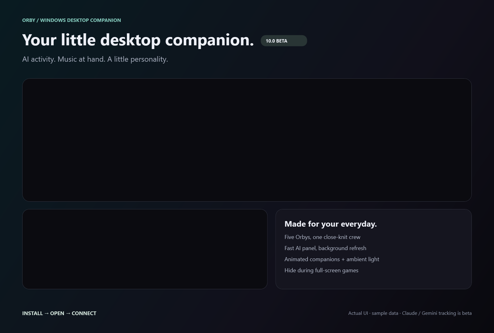
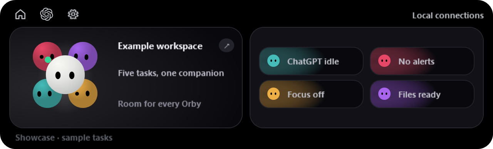
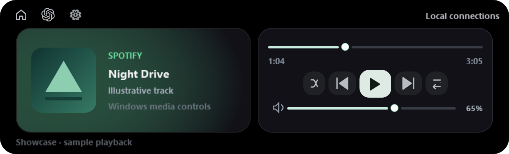
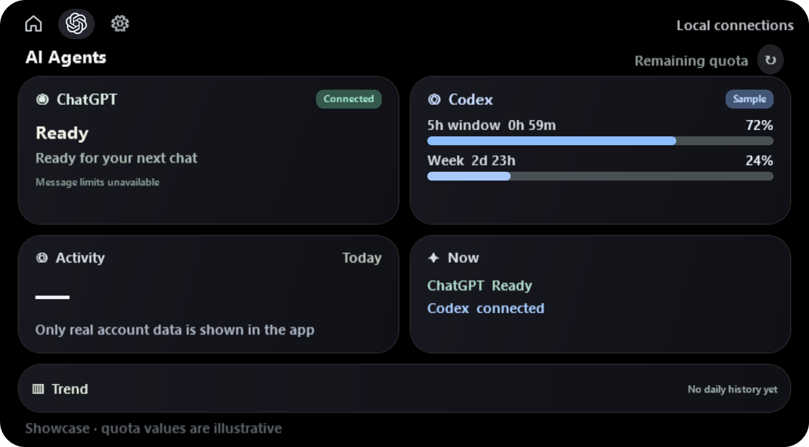
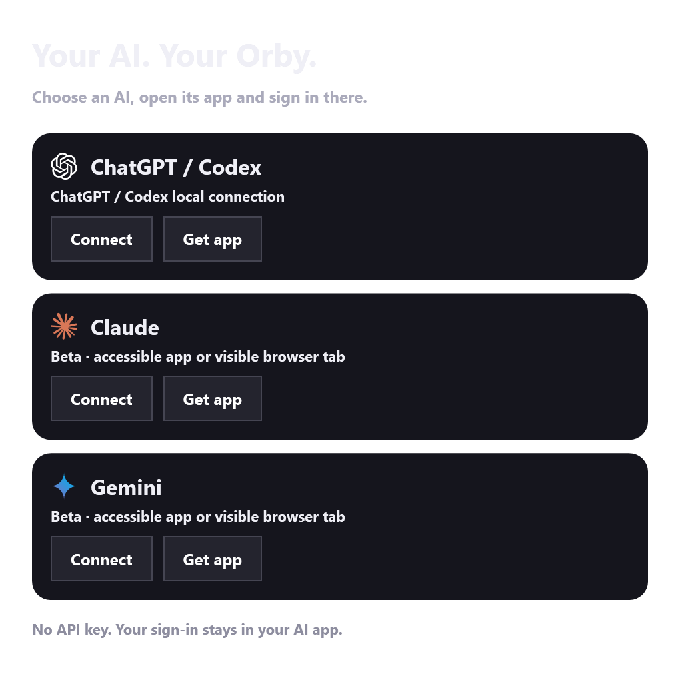
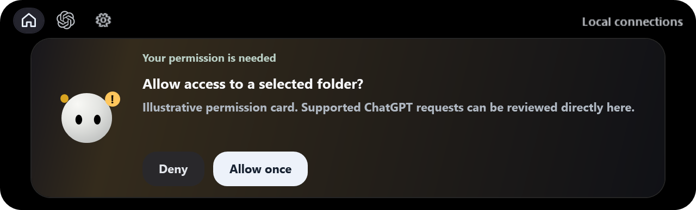



# Orby · Windows desktop companion

A little friend at the top of your screen. Follow AI activity, control your music and enjoy animated companions—all in one compact notch.

**[Download the beta](https://github.com/kevinenas/Orby/releases)** · [See the UI](#a-look-inside) · [Provider compatibility](#ai-connections) · [Validation](VALIDATION.md)

## Install → open → connect

1. Download **Orby-Setup.exe** from Releases and click **Install Orby**.
2. Click **Open Orby** and choose your AI in the connection picker.
3. Click **Connect**. Sign in inside that AI's own app if needed. If it isn't installed, **Get app** opens the official download page; Connect can also open its website.

No API key, password sharing or copied account files. Switch later under **Settings → AI connections**. Right-click the connected AI menu button for the picker. Keep the provider's app open or its supported browser tab selected so its accessible status can be read.

For portable use, extract **Orby-Windows.zip** and open **Orby.exe**. Keep the supporting files beside it. Source is also available as **Orby-Source.zip**.

## What's new in this beta

| Area | Updates |
|---|---|
| AI connections | ChatGPT/Codex retained; Claude and Gemini app/browser options with bundled provider logos, official download links and honest unavailable-status labels. |
| Fast AI tab | Account fetching starts in the background; recent local data is ready when the tab opens. Temporary refresh failures retain still-valid information. First-time data needs a service response. |
| Five-Orby layout | White Orby in front, four colored companions tightly tucked behind it, and dedicated text space. The familiar compact cluster is back. |
| UI and lighting | Compact opaque-black palette, bold typography, circular characters, slow animated ambient glows and album-color lighting in the compact notch. |
| Permission cards | Supported ChatGPT approvals can be reviewed in the notch. The home footer and compact text disappear immediately beneath overlays. |
| Music | Album-cover access, responsive seek feedback, playback controls, shuffle/repeat and a working Windows output-volume slider. |
| Games and displays | Hide during full-screen games/apps, restore afterward, adapt to monitor scaling and use display-paced animation. Achievable frame rate depends on the system. |
| Character options | Animated colored companions, occasional eye styles, reduced motion and sound settings. The internal animation library remains available to the app. |
| Windows package | Quiet executable launch and a per-user installer. Existing local settings/history stay outside the versioned app folder. |

## A look inside

These images are rendered from the current UI. Tasks, playback, cover art and quota values are **illustrative samples**, not a live user's account. Availability depends on the connected app and its readable signals.

### Home: room for every Orby

### Music inside the notch

Click the cover art to open the player. Leaving the expanded notch returns it to Home. Output volume affects **all apps**, not only Spotify. Seeking and playback depend on what the Windows media session supports.

### AI status and remaining quota

Quota bars apply to **Codex**, not ordinary ChatGPT message limits or API credits. Other providers' quota/token information is not fabricated. Fresh account data is retained locally for quick opening and expires after three minutes; expired quota windows are hidden.

### Choose your connection

### Review supported permissions

Scheduled reminders remain ordinary notifications. Conversational wording alone doesn't become an approval request. Claude/Gemini approvals and file attachments stay in their own apps.

## AI connections

| Provider | Current support | Limits |
|---|---|---|
| ChatGPT Windows / local Codex | Existing local activity integration, supported inline permission handling, file handoff and Codex account information where supplied. | Ordinary ChatGPT message limits are unavailable; access depends on local app signals. |
| Claude | **Beta:** opens the installed app or claude.ai; reads accessible composer and stop-generation controls. | Signed-in end-to-end validation is pending. Approvals, attachments and account quota stay in Claude. |
| Gemini | **Beta:** opens the installed app or gemini.google.com; reads accessible composer and stop-generation controls. | Signed-in end-to-end validation is pending. Approvals, attachments and account quota stay in Gemini. |
| Other providers | Not supported yet. | A tested adapter is required. This is not a universal AI connector. |

The menu icon changes to the selected connected provider: OpenAI, Claude or Gemini. Logos are bundled for offline use. Switching back restores the OpenAI icon; saved selections are normalized on startup. Sign-in screens are not reported as connected.

Only verified readable connections are shown as connected. Hidden tabs, inaccessible app content and stale snapshots can't provide live status. The app distinguishes “open but status unavailable” from a readable connection.

Official apps: [ChatGPT](https://chatgpt.com/download/) · [Claude](https://claude.com/download) · [Gemini](https://gemini.google/desktop/)

## Privacy, requirements and safety

- Windows 10/11, Windows PowerShell 5.1 and .NET Framework/WPF are required.
- Settings, account cache and diagnostics stay under `%LOCALAPPDATA%\Orby`.
- Public packages exclude personal settings, chat captures, histories, API keys and sign-in files. Orby doesn't host an account-data server.
- Local accessibility/log readers and Windows media sessions supply supported app signals. Diagnostic captures are optional: review them before sharing.
- Automatic startup is disabled in this security build. No scheduled tasks, execution-policy overrides or antivirus exclusions are added.
- Executables are unsigned. Don't disable security protection to install them; report a detection with its details. See [Security](SECURITY.md).

## Open source and validation

MIT licensed, with third-party notices in `third-party`. App source and focused tests live in `src/`; screenshots live in `docs/`. Executable downloads belong in Releases. Run `Build.ps1` in Windows PowerShell to build `dist/Orby-Setup.exe` and `dist/Orby-Windows.zip`. Keep runtime files together.

[VALIDATION.md](VALIDATION.md) records local checks and limits. Detector, provider filtering, stale-state handling, music input, five-Orby spacing, overlay hiding and background AI refresh have focused checks. Claude/Gemini live sign-in testing remains pending; beta status is intentional.

Found a bug? Open an issue with your Windows version, provider/app, display scaling and steps to reproduce. Remove private information from screenshots and logs first.
