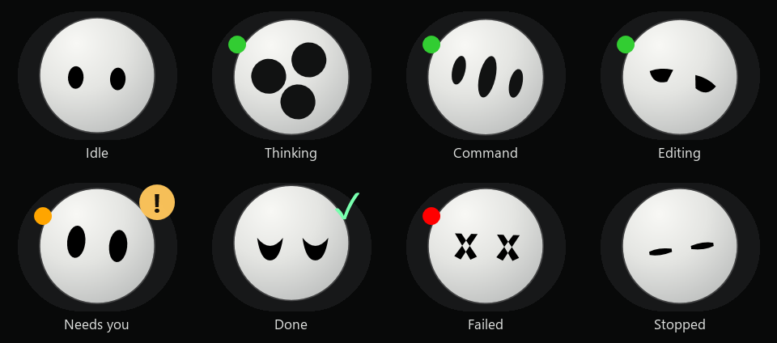
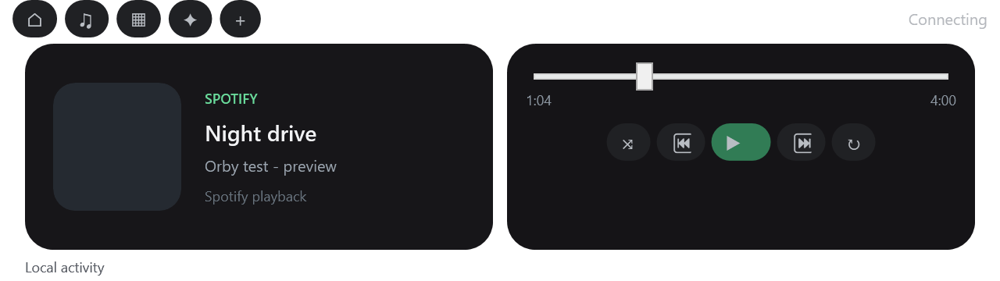
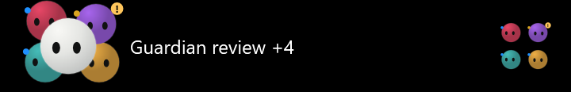

# Orby

Orby is a small Windows desktop companion for ChatGPT. It lives at the top of the screen, reacts to local ChatGPT activity, shows task companions, displays Spotify playback, and provides a compact file-to-new-chat handoff.

## Install and connect ChatGPT

1. Download or clone this repository on Windows.
2. Extract it to a permanent folder. Do not run it from a temporary ZIP preview.
3. Double-click `Orby.exe` for the easiest quiet launch, or use `Start-Orby.cmd` as the fallback launcher. Use `Start-Orby-Debug.cmd` when you want to see the diagnostic window.
4. Leave the ChatGPT Windows app open. Orby watches the local ChatGPT/Codex activity and Windows UI signals; it does not need an API key.
5. Move the pointer to the top edge to expand the notch. The first launch greets you with a boot glow and wave.

Orby registers itself to start with Windows by default. To change this later, open Settings from the notch and toggle `Start Orby with Windows`. `Enable-Orby-Startup.cmd` is a manual fallback for profiles that block the app from writing the per-user startup entry.

## What works

- Normal ChatGPT and Work/Codex activity tracking with LIVE, DONE, STOP, FAIL, and NEEDS YOU states when the local signal is available.
- A white primary Orby plus colored task companions for additional active tasks.
- Small idle gestures, thinking variations, greeting wave, reduced-motion mode, and optional soft sound cues.
- Drag-and-drop file handoff: drop a file on Orby, enter a prompt, and Orby opens a new ChatGPT chat, pastes the file and prompt, then attempts to send after confirming the composer.
- Spotify cover art in the compact notch. Click it to open the Music tab inside the expanded notch. The tab includes play/pause, previous, next, shuffle, repeat, position, duration, and seeking when Windows exposes that capability.
- System settings for music, sounds, quiet mode, reduced motion, notifications, downloads, tasks, watchlist, and startup.

## Spotify

Open Spotify and play a track before testing the cover art. Orby uses Windows media-session controls, so playback actions depend on what Spotify and Windows expose for the current track. No Spotify credentials or API keys are stored. If Windows denies media-session access, the player stays visible and explains that Spotify is unavailable.

## ChatGPT connection limits

Orby is a local Windows companion, not a ChatGPT plugin. It reads signals exposed by the installed ChatGPT app and its local activity/log surfaces. UI labels and desktop permissions can change between ChatGPT releases, so the included capture helpers are useful when a signal is missing:

- `Capture-ChatGPT-UI.cmd`
- `Capture-ChatGPT-Logs.cmd`
- `Capture-ChatGPT-Controls.cmd`

Run these only while ChatGPT is open and actively showing the state you want to diagnose. The capture files are written under `%LOCALAPPDATA%\Orby`.

## Requirements

- Windows 10 or Windows 11
- Windows PowerShell 5.1
- A normal desktop session with WPF enabled
- The ChatGPT Windows app for local ChatGPT tracking
- Spotify desktop for music controls

The source is ASCII-safe and does not require Node, Python, a server, or an API key.

`Orby.exe` is a small Windows launcher beside the PowerShell/WPF files. Keep the whole extracted folder together; the executable starts the included `Orby.ps1` and does not need a separate installer. This keeps the app inspectable and preserves the built-in PowerShell 5.1 compatibility.

## Validation

The release was checked with the animation catalog, idle scheduler, companion sync, music timeline/control routing, embedded Music tab rendering, artwork cache, task pack, and WPF startup checks. See `VALIDATION.txt` for the detailed local results and known environment limits.

## Project layout

| Path | Purpose |
| --- | --- |
| `Orby.ps1` | Main WPF app and state presentation |
| `Native-Avatar.cs` | Render-paced Orby avatar and companion animation |
| `Animation-Catalog.cs` | Animation definitions |
| `Reference-Home.xaml` | Expanded notch Home and Music pages |
| `Reference-Home.ps1` | Home/Music page behavior |
| `Media-Worker.ps1` | Spotify artwork and playback-session polling |
| `Spotify-Control.ps1` | Play, pause, skip, repeat, shuffle, and seek routing |
| `Start-Orby.cmd` | Quiet one-click launcher |
| `Settings.xaml` | Settings window |
| `*preview*` | Key screenshots and animation previews |

## License

MIT. See `LICENSE`.

See `SECURITY.md` for the local-only connection model and files that must never be committed.
