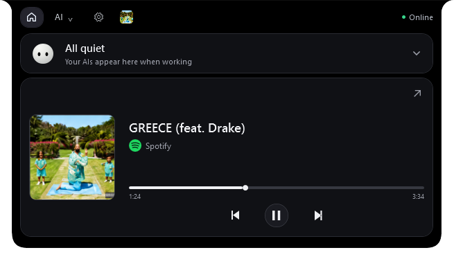
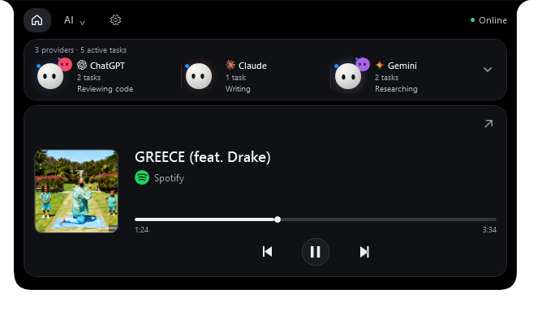

# Orby 10.40 · Windows desktop companion

A small animated companion at the top of your screen for AI activity, tasks and music.

**[Download Orby 10.40](https://github.com/kevinenas/Orby/releases/tag/v10.40-beta)** · [Privacy and security](SECURITY.md) · [Validation](VALIDATION.md)

## Install or update

1. Download **Orby-Setup.exe** from the release.
2. Quit Orby from its tray icon if it is running, then run setup and choose Install or Update.
3. Click Open Orby. Use the desktop shortcut next time.

Setup reuses the existing managed installation and preserves preferences in `%LOCALAPPDATA%\Orby`. New installations default to `%LOCALAPPDATA%\Programs\Orby`. Startup is optional. For portable use, extract **Orby-Windows.zip** completely and open `Orby.exe`; keep its supporting files together. Use setup to update a managed installation in place.

Windows x64, Windows PowerShell 5.1 and desktop .NET Framework/WPF are required. This build is unsigned. If Windows Security detects a threat, leave it blocked and report the detection; do not disable protection or add exclusions.

## New in 10.40

- **Quiet black Home:** neutral charcoal cards matching Settings and AI pages. A compact AI overview sits above a full-width music player. Weather has been removed.
- **One AI chooser:** the AI button expands ChatGPT, Claude and Gemini. Provider pages retain task details and inline usage bars where readings are available.
- **Task companions:** working companions sit behind the main Orby. Click a companion or active-task count to inspect available task information.
- **Adaptive Mini:** active provider context can widen the closed notch, then shrink as work finishes.
- **Smoother interactions:** reversible hover/resize transitions, menu fades, animated usage bars and double-click wake-up feedback. Reduced motion remains available.
- **Direct file handoff:** drop files, choose ChatGPT, Claude or Gemini, add an optional message and Send. Orby opens the selected app/site and pastes the file list directly, without opening a file chooser. It inserts your message, checks upload readiness and sends once.
- **Roomier Settings:** scrolling options and accessible Save/Close controls.

The public edition has no water card, drinking reminders, intake tracking or water animation assets. No personal module or user data is included.

## Home preview

Actual WPF renders using **sample tasks and playback**, not a live account or guaranteed service state.





## Connect your AI apps

Open **Settings → AI connections** and choose your provider. Sign in through that provider's own application or official website. Orby does not ask you to copy a password or API key.

| Provider | Activity and usage |
|---|---|
| ChatGPT / Codex | Available local activity feeds and supported desktop accessibility controls. Usage bars show connected **Codex** five-hour/weekly allowance; normal ChatGPT message limits and API credits are separate. |
| Claude | Supported desktop/browser activity, plus optional Claude Code integration. Account usage needs the supported English usage page visible in a non-minimized browser. |
| Gemini | Supported desktop/browser activity. Account usage is shown only when a supported visible usage page exposes readable values. |

Missing, stale or conflicting quota readings show **Not available**. Orby does not invent percentages, task context or reset times. App/site layout and language changes can affect compatibility. Supported ChatGPT question and permission cards require an explicit user answer; other provider approvals may remain in their original apps.

## File drop

Drop up to 20 files onto Orby, choose an AI and click Send. Keep that signed-in app in front during transfer. Supported filenames, upload types, account permissions, connectivity and provider accessibility controls are required. Actual provider upload time varies with file size and network conditions.

Close or Escape returns Home; Back changes the AI before sending. Orby returns Home after a confirmed send. It does not automatically retry an uncertain send. Attachments may already have reached the provider even if the message is not sent; closing Orby cannot undo an accepted upload or send. Check the target app before retrying.

## Music

Play music in your player. Home displays its actual Windows media artwork, timeline and available playback controls. Click the arrow for the music page and source options. Browser media may expose fewer controls. App-volume support depends on the player; Windows output volume affects the selected output device. No Spotify API key is required.

## Build from source

On Windows, open Windows PowerShell in the repository and run:

```powershell
.\Build.ps1
```

This compiles the launcher, Claude observer and file-transfer helper from `src/`, then creates `dist/Orby-Setup.exe` and `dist/Orby-Windows.zip`. Setup embeds that exact ZIP and its SHA-256 file manifest. Normal Windows execution policy still applies; the app and setup do not change it.

Source and release downloads are tied to the same `v10.40-beta` commit. The manual `Orby-Source.zip` includes the source, packaging scripts, documentation and licenses. Checksums are in `SHA256SUMS.txt`; rebuilding may produce different binary hashes because the compiler is not configured for deterministic builds.

Licensed under MIT. Third-party source and notices are retained under `src/third-party/` and `src/THIRD-PARTY-NOTICES.txt`.
